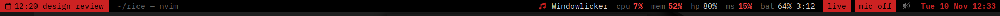
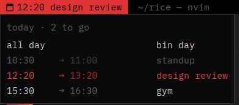

# redline

A GNOME Shell extension that turns the top bar into something like tmux's
status line: a tag block on the left, workspaces as tmux windows, the focused
window's title, then a quiet strip of whatever needs attention on the right.
OLED black, red and greys, square corners, a monospace Nerd Font.



Most segments stay hidden until there's something to say. CPU and memory only
show when they're high, the battery only when it's unplugged or charging, and
Wi-Fi only when the signal is weak.

## Segments

Left to right:

- **Tag:** the block where tmux keeps its session name. It shows the next
  thing on your day and turns red when it's urgent. Hover for the day; click
  (or Super) opens the overview, since it replaces Activities. With nothing
  to show it's the hostname. Where the day comes from is pluggable; see
  [The tag](#the-tag).
- **Workspaces:** `1 [2] 3`. The current one is a red block, ones with
  windows are bright, empty ones dim. Click to switch, scroll to step. GNOME's
  spare empty workspace is hidden unless you're on it, and the whole segment
  hides while there's only one.
- **Window title:** the focused window's title, dim, with the trailing
  `— App Name` cut. Hover a cut-off title to see all of it.
- **Now playing:** whatever MPRIS player is playing (Spotify, a browser tab,
  mpv). The artist is dropped when it won't fit. Click to play or pause,
  scroll to skip, middle-click to jump to its window, and hover for a card
  with art, album and a progress bar.
- **cpu / mem:** an alert, not a readout. They show only at 85% or above
  (CPU has to stay there for 6 s, so a page load doesn't flash it).
- **Device batteries:** `hp 80%  ms 15%`, any Bluetooth or wireless device
  UPower knows about. Red at 20% or below.
- **Battery:** `bat 64% 3:12` on battery with the time left, `chg` while
  charging, hidden on mains.
- **live / rec 0:42 / mic off:** loud red blocks while the screen is shared or
  recorded (click to stop) and while the mic is muted. `mic <apps>` names
  whatever is listening to a microphone. These replace GNOME's own small
  icons.
- **Quick settings and the clock:** GNOME's own, moved to the far right like
  tmux's clock and restyled. Their status icons are kept quiet: no night
  light, mic or notification icons, Wi-Fi only when the signal is poor, volume
  only when muted.

It also pops GNOME's OSD box (the volume one) when the keyboard layout
changes, and when a script asks it to with [`redline-osd`](#redline-osd).

## The tag



The tag gets its day from a source module:

- **calendar** (the default): today's events from GNOME's calendar, meaning
  whatever Evolution Data Server syncs (GNOME Calendar, Online Accounts).
  It shows the event that's on now, or the next one, and goes red while an
  event is on or starts within 10 minutes. The card lists the whole day with
  past events dimmed. It reads the clock menu's event source rather than
  opening its own, because the calendar server keeps a single time range and
  two clients would empty each other's events.
- **helm**: my day planner's CLI (`helm missed --json`). It's used
  automatically when that CLI exists and won't apply to anyone else, but it
  shows what a richer source looks like: ranked tiers, and red for missed
  blocks.

`REDLINE_TAG=calendar|helm` forces one. A source is a small class in
`redline@zain/` with `fetch()` and `view()`; the interface is described at
the top of [`tag.js`](redline@zain/tag.js), so adding another (a todo list,
a CI status) is one file plus a line in `pickSource()`.

## Requirements

- GNOME Shell 46 (Ubuntu 24.04). Other versions aren't tested.
- [BlexMono Nerd Font](https://www.nerdfonts.com/) for the text and glyphs.
- Optional: a shell theme for the menus. The bar itself is styled by its
  own `stylesheet.css`. On my machine a matching shell theme squares off and
  recolours GNOME's menus, but that lives in my dotfiles, not here.
- It hides Activities and moves the clock, so turn off other extensions that
  also rearrange the panel.

## Install

```sh
git clone https://github.com/iamzainrizwan/redline
cd redline
./install.sh --link   # or ./install.sh to copy instead of symlinking
```

Then log out and back in: on Wayland, GNOME only loads a new extension at
login. `--link` symlinks the clone, so `git pull` plus a re-login updates it.
`./install.sh --uninstall` takes it out again.

It installs two scripts into `~/.local/bin` (`BIN=dir` to change that):

### redline-osd

```sh
redline-osd video-display-symbolic "60 Hz"
```

Pops GNOME's OSD box from any script. Scripts can't call the shell's ShowOSD
themselves, so this writes to `$XDG_RUNTIME_DIR/redline-osd` and the bar shows
it. Unlike `notify-send`, it shows under Do Not Disturb.

### buds

```sh
buds            # mode and battery
buds nc         # noise cancelling; also trans, off, high/mid/low/adaptive
buds ldac       # codec; dual on|off for multipoint
```

Noise control for Nothing and CMF earbuds over their own Bluetooth protocol,
with no app. When connected buds are ones it knows, hovering their battery in
the bar drops a card to switch modes, codec and dual connection.

## Environment

The extension reads these from GNOME Shell's environment (set them in
`~/.config/environment.d/` and log out); the test sets most of them itself.

| Variable | Default | What it does |
| --- | --- | --- |
| `REDLINE_TAG` | helm if its CLI exists, else calendar | force the tag's source: `calendar` or `helm` |
| `REDLINE_HELM` | `~/vault/helm/cli/helm` | path to the helm CLI |
| `REDLINE_BUDS` | `buds` on `PATH`, else `~/.local/bin/buds` | the script the buds card runs |
| `REDLINE_HOT_PERCENT` | `85` | the cpu/mem alert threshold |
| `REDLINE_UPOWER_BUS` | the system bus | `session` reads UPower off the session bus (the test's fake) |
| `REDLINE_OSD_FILE` | `$XDG_RUNTIME_DIR/redline-osd` | the file `redline-osd` writes and the bar watches |

## Testing

```sh
bin/redline-test
```

Runs the extension in a throwaway headless GNOME Shell with its own D-Bus
session and scratch XDG dirs, so it never touches your live session or
settings. It prints the panel layout and checks a disable/enable cycle (what
the lock screen does), then leaves screenshots in the output dir.
Environment variables add fakes:

| Variable | What it does |
| --- | --- |
| `REDLINE_TEST_UPOWER=1` | a fake battery, headphones and mouse; forces the cpu/mem alerts and live/mic tags on |
| `REDLINE_TEST_CALENDAR=1` | a fake calendar server with four events today, on the calendar tag |
| `REDLINE_TEST_TRACK='title'` | the fake player's track title |
| `REDLINE_TEST_HOVER=<role>` | draw that panel item hovered (`redline-tag`, `redline-nowplaying`, `dateMenu`) |
| `REDLINE_TEST_OPEN=<role>` | open that item's menu (`quickSettings`) |
| `REDLINE_TEST_SHOW=overview\|apps\|lock` | screenshot with the overview, app grid or lock screen up |

The isolation only holds because the XDG variables are set before
`dbus-run-session` starts: dconf inherits the bus daemon's environment, so
setting them later would write to your real settings. Two guards abort the
run if isolation fails.

## License

MIT
